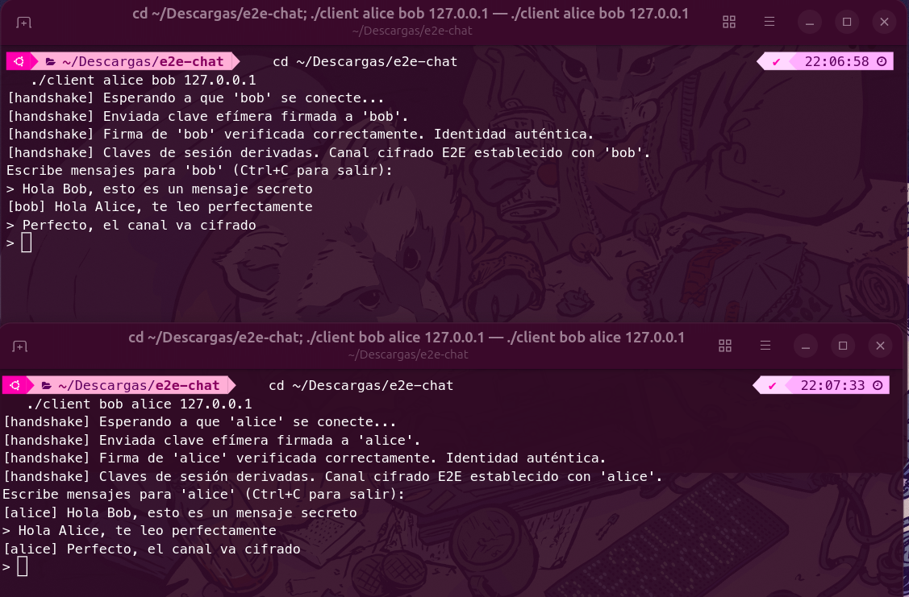
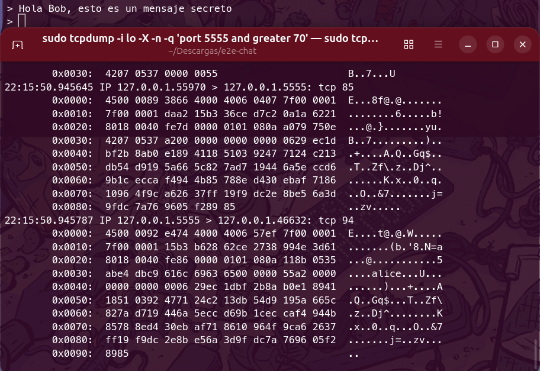
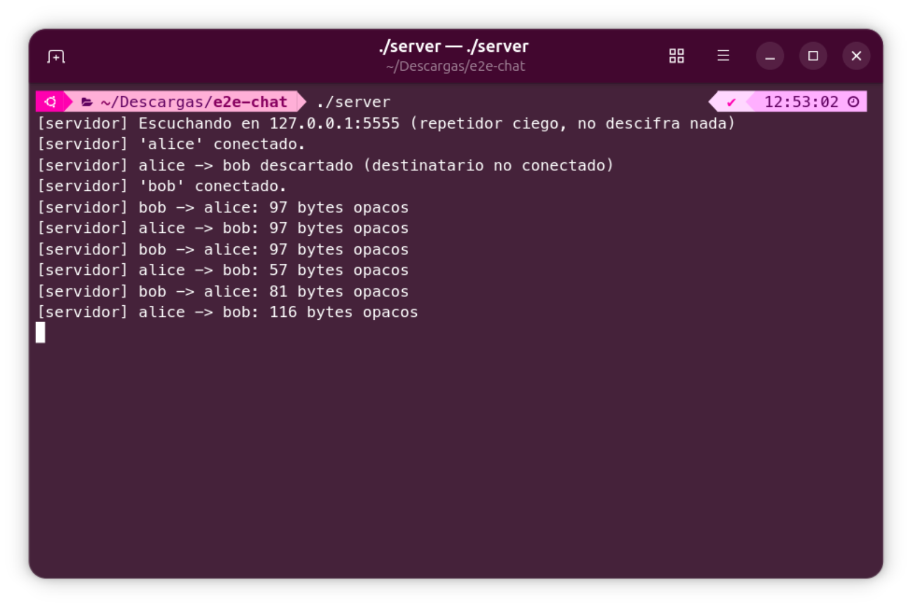

# Chat cifrado de extremo a extremo en C

[English](README.md) · Español

Mensajería cliente-servidor sobre sockets TCP con cifrado de extremo a extremo. El servidor solo reenvía bytes opacos, así que no puede leer las conversaciones. El protocolo de handshake autenticado está implementado a mano sobre [libsodium](https://doc.libsodium.org/).

Paula Díaz Collado · Grado en Ingeniería Informática, Universidad Carlos III de Madrid

Stack: C11, sockets POSIX, pthreads, libsodium (X25519, Ed25519, XChaCha20-Poly1305), Make y Bash.

Es un proyecto personal y el protocolo no ha sido auditado, así que no sustituye a Signal, TLS ni Noise (ver [Limitaciones](#limitaciones)). Nació como un proyecto de una asignatura de la universidad y lo reescribí y amplié por mi cuenta, con handshake robusto, validación de entrada, protección anti-repetición y tests de integración.

## Demostración

| Chat con el canal cifrado establecido | Tráfico visto con `tcpdump` |
|---|---|
|  |  |

En los clientes el texto se lee, y en la red solo hay bytes cifrados. El servidor únicamente registra metadatos:



## Propiedades

| Propiedad | Cómo |
|---|---|
| Confidencialidad frente a la red y al servidor | Los dos clientes derivan una clave de sesión que el servidor nunca conoce |
| Autenticación del interlocutor | La clave efímera de cada lado va firmada con su identidad Ed25519, que se comprueba contra una clave pineada de antemano |
| Integridad | Cifrado autenticado (AEAD): cualquier bit alterado hace fallar el descifrado |
| Repeticiones y reordenación | Número de secuencia dentro de los datos autenticados; se rechaza cualquier `seq` que no crezca |
| Forward secrecy por sesión | Claves X25519 efímeras que solo viven en memoria |
| Entrada de red no fiable | Longitudes y nombres validados; probado con tramas malformadas bajo AddressSanitizer |

## Protocolo

```
   Alice                     Servidor (repetidor ciego)                   Bob
     │── REGISTER "alice" ───────────►│◄─────────────── REGISTER "bob" ──────│
     │── HANDSHAKE(eph_A, firma_A) ──►│── reenvía sin interpretar ───────────►│
     │◄─ reenvía sin interpretar ─────│◄─────── HANDSHAKE(eph_B, firma_B) ────│
     │  verifica firma_B con ID_B     │          verifica firma_A con ID_A    │
     │  deriva (rx, tx)               │          deriva (tx, rx)              │
     │── DATA(seq, nonce, cifrado) ──►│── reenvía ───────────────────────────►│
```

**Handshake.** Cada lado genera un par efímero X25519 y firma `"e2echat-hs-v1" ‖ remitente ‖ destinatario ‖ clave_efímera` con su identidad Ed25519. Los nombres y la etiqueta de versión ligan la firma a su contexto. Con `crypto_kx` se derivan dos claves, una por sentido, lo que evita ataques de reflexión. El rol de `crypto_kx` se decide por orden alfabético de los nombres, así que no hace falta negociarlo.

**Mensajes.** `[0xA2][seq u64][nonce 24 B][cifrado + tag 16 B]` con XChaCha20-Poly1305. La cabecera `[0xA2][seq]` se autentica como dato asociado. El nonce de 24 bytes es aleatorio y lo bastante largo como para no preocuparse por colisiones.

**Orden de arranque.** El handshake se reenvía cada segundo hasta que hay sesión, y al recibir el primero del otro lado se responde con el propio. Da igual quién arranque antes.

**Transporte.** Tramas con longitud prefijada (`tipo, len(destino), destino, len(payload), payload`) sobre TCP. El servidor solo entiende este nivel.

## Modelo de amenazas

Protege frente a:
- un atacante pasivo que lea el tráfico de red;
- un servidor comprometido: no puede leer, modificar sin que se detecte ni inyectar mensajes;
- un atacante activo que modifique, repita o reordene mensajes;
- la suplantación del interlocutor (man-in-the-middle), siempre que la clave pública se haya intercambiado por un canal de confianza.

No protege frente a:
- los metadatos: el servidor y la red ven quién habla con quién, cuándo y cuántos bytes;
- la denegación de servicio: un servidor malicioso puede descartar o retrasar mensajes;
- un equipo comprometido: quien robe `*.identity` puede suplantar a ese usuario;
- un pineado erróneo: si se guarda una clave falsa, se autentica al impostor (el mismo supuesto que `known_hosts` en SSH).

## Uso

Requisitos: `gcc`, `make` y libsodium.

```bash
sudo apt install build-essential libsodium-dev    # Debian/Ubuntu
make
```

1. Servidor (por defecto en `127.0.0.1:5555`; con `./server 5555 0.0.0.0` acepta conexiones de la red):
   ```bash
   ./server
   ```
2. Identidades, una por usuario. Imprime la clave pública y crea `<usuario>.identity` con permisos 0600:
   ```bash
   ./keygen alice
   ./keygen bob
   ```
3. Pineado. Cada usuario guarda la clave pública del otro en su `contacts.txt`. En un caso real se intercambian por un canal de confianza; en una demo local, en el mismo directorio:
   ```bash
   echo "alice $(cat alice.pub.txt)" >> contacts.txt
   echo "bob $(cat bob.pub.txt)"     >> contacts.txt
   ```
4. Clientes, cada uno en su terminal y en cualquier orden:
   ```bash
   ./client alice bob 127.0.0.1
   ./client bob alice 127.0.0.1
   ```

Cuando aparece `Canal cifrado E2E establecido` ya se puede escribir. Para ver el tráfico cifrado: `sudo tcpdump -i lo -A port 5555`.

Si se regeneran las identidades hay que borrar `contacts.txt` y repetir el paso 3. Se usa la primera entrada de cada usuario para que un cambio de clave sea una alerta y no una actualización silenciosa.

## Tests

```bash
make test    # unitarios e integración, unos 35 s
```

- `tests/test_crypto.c`: propiedades de las primitivas y del diseño (firmas, MITM, claves por sentido, manipulación, cabecera autenticada).
- `tests/integration.sh`: servidor y clientes reales, cada usuario en su directorio:
  1. chat con el orden de arranque invertido, sin alertas falsas;
  2. el log del servidor no contiene el texto en claro;
  3. tramas malformadas (nombre de 255 bytes, longitud `0xFFFFFFFF`, bytes aleatorios): el servidor sigue vivo;
  4. MITM simulado con una clave pineada falsa: se detecta la firma inválida y no se entrega ningún mensaje;
  5. contacto sin pinear: el cliente aborta con instrucciones;
  6. usuario `../evil` (path traversal): se rechaza.

La suite también se ha pasado compilando con `-fsanitize=address,undefined`, sin errores. Los binarios se compilan sin advertencias con `-Wall -Wextra -Wpedantic -fstack-protector-strong -D_FORTIFY_SOURCE=2`.

## Estructura

```
src/protocol.{h,c}   Tramas TCP y validación de entrada
src/identity.{h,c}   Identidad Ed25519 y contactos pineados
src/server.c         Servidor repetidor, un hilo por cliente
src/client.c         Handshake, derivación de claves, cifrado y anti-repetición
src/keygen.c         Creación de identidades
tests/               Prueba unitaria y prueba de integración con ataques
```

## Decisiones de diseño

- libsodium en lugar de OpenSSL: su API de alto nivel hace difícil equivocarse con nonces, padding o comparaciones en tiempo constante.
- Pineado manual en lugar de una PKI: deja a la vista el problema de distribuir claves, que es la parte difícil de cualquier sistema E2E.
- Un hilo por cliente en el servidor: es simple y basta para este alcance. Una versión más seria usaría `epoll`.

## Validación de la entrada

Al revisar el código encontré que `recv_frame` copiaba la longitud del nombre, que llega en un byte (hasta 255), a un búfer de 33 bytes. Un cliente malicioso podía desbordar la pila del servidor. Ahora se valida la longitud antes de leer, y el test de tramas malformadas lo cubre: contra la versión sin esa comprobación, AddressSanitizer informa de un `stack-buffer-overflow`.

## Limitaciones

- No hay ratchet: cada ejecución usa una sola clave de sesión. Signal la renueva en cada mensaje (Double Ratchet), así que si se compromete la clave de sesión queda expuesta toda esa sesión.
- El handshake no incluye frescura. Alguien podría reenviar un handshake antiguo y dejar la sesión inutilizable, aunque no leería ni suplantaría nada. Se arreglaría con un desafío-respuesta.
- No hay mensajes offline: si el destinatario no está conectado, el mensaje se descarta.
- Solo conversaciones 1 a 1. El E2E en grupos (por ejemplo MLS) es bastante más complejo.
- El pineado es manual. Una mejora natural es TOFU con alerta si cambia la clave de un contacto, y verificación con QR o números de seguridad.
- El servidor usa un único candado global y E/S bloqueante, suficiente para una demo pero poco escalable.
