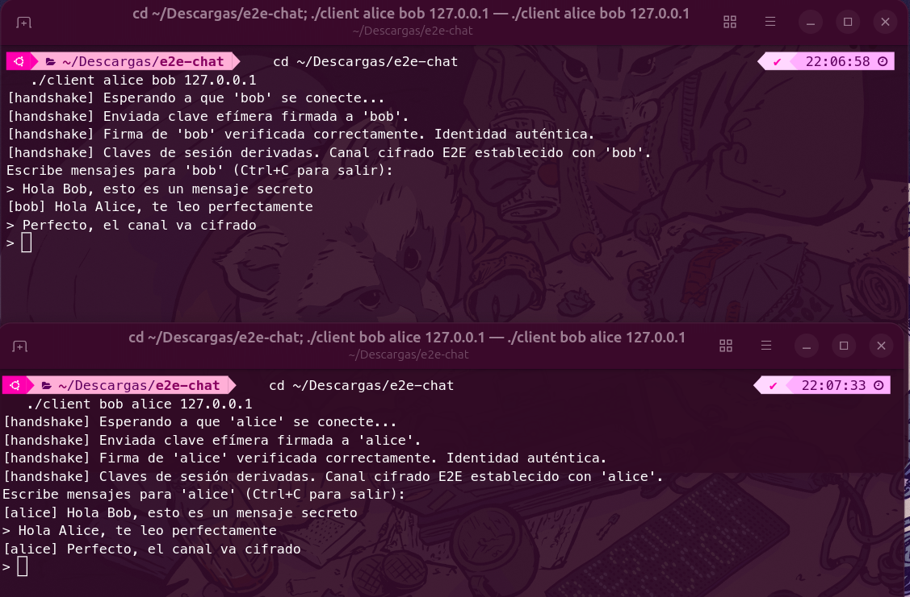
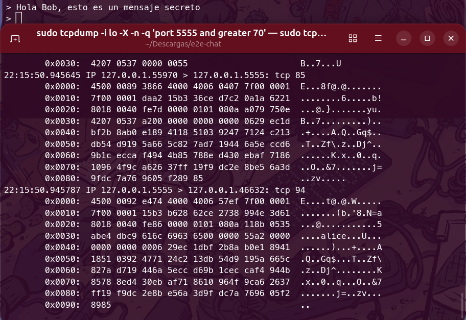
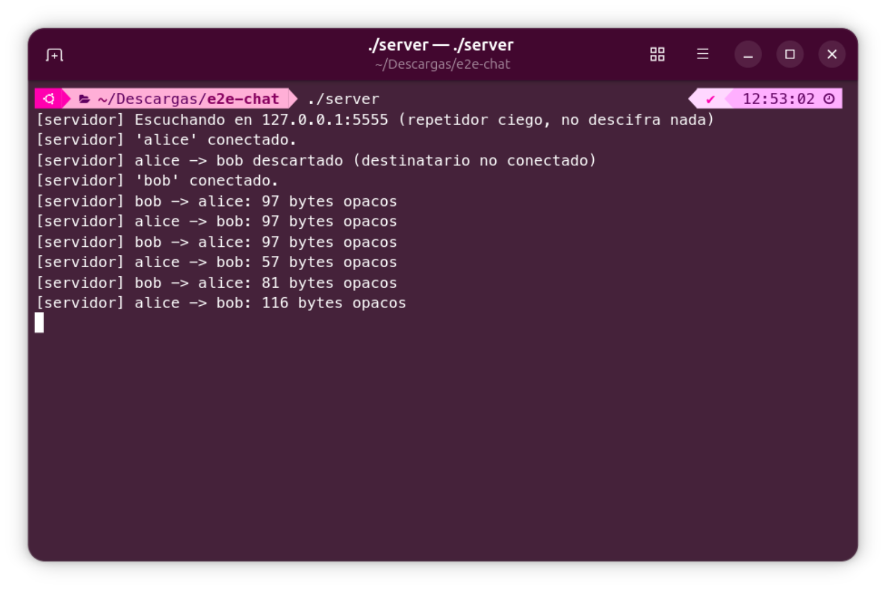

# End-to-end encrypted chat in C

English · [Español](README.es.md)

Client-server messaging over TCP sockets with end-to-end encryption. The server only relays opaque bytes, so it cannot read the conversations. The authenticated handshake protocol is implemented by hand on top of [libsodium](https://doc.libsodium.org/).

Paula Díaz Collado · BSc in Computer Science and Engineering, Universidad Carlos III de Madrid

Stack: C11, POSIX sockets, pthreads, libsodium (X25519, Ed25519, XChaCha20-Poly1305), Make and Bash.

This is a personal project and the protocol has not been audited, so it is not a replacement for Signal, TLS or Noise (see [Limitations](#limitations)). It started as a university course project and was rewritten and extended on my own, with a hardened handshake, input validation, replay protection and integration tests.

## Demo

| Chat with the encrypted channel established | Traffic seen with `tcpdump` |
|---|---|
|  |  |

The clients can read the text, while on the network there are only encrypted bytes. The server only logs metadata:



The program's output is in Spanish, which is why the screenshots are too.

## Properties

| Property | How |
|---|---|
| Confidentiality against the network and the server | Both clients derive a session key that the server never learns |
| Peer authentication | Each side's ephemeral key is signed with its Ed25519 identity, which is checked against a key pinned beforehand |
| Integrity | Authenticated encryption (AEAD): any altered bit makes decryption fail |
| Replay and reordering | Sequence number inside the authenticated data; any `seq` that does not increase is rejected |
| Per-session forward secrecy | Ephemeral X25519 keys that only live in memory |
| Untrusted network input | Lengths and names are validated; tested with malformed frames under AddressSanitizer |

## Protocol

```
   Alice                     Server (blind relay)                      Bob
     │── REGISTER "alice" ───────────►│◄─────────────── REGISTER "bob" ──────│
     │── HANDSHAKE(eph_A, sig_A) ────►│── forwards unread ───────────────────►│
     │◄─ forwards unread ─────────────│◄──────── HANDSHAKE(eph_B, sig_B) ─────│
     │  verifies sig_B with ID_B      │          verifies sig_A with ID_A     │
     │  derives (rx, tx)              │          derives (tx, rx)             │
     │── DATA(seq, nonce, cipher) ───►│── forwards ──────────────────────────►│
```

**Handshake.** Each side generates an ephemeral X25519 pair and signs `"e2echat-hs-v1" ‖ sender ‖ recipient ‖ ephemeral_key` with its Ed25519 identity. The names and the version label bind the signature to its context. `crypto_kx` derives two keys, one per direction, which prevents reflection attacks. The `crypto_kx` role is decided by alphabetical order of the names, so no negotiation is needed.

**Messages.** `[0xA2][seq u64][nonce 24 B][ciphertext + tag 16 B]` with XChaCha20-Poly1305. The `[0xA2][seq]` header is authenticated as associated data. The 24-byte nonce is random and long enough that collisions are not a concern.

**Startup order.** The handshake is resent every second until a session exists, and on receiving the first one from the other side, the client replies with its own. It does not matter who starts first.

**Transport.** Length-prefixed frames (`type, len(destination), destination, len(payload), payload`) over TCP. The server only understands this level.

## Threat model

Protects against:
- a passive attacker reading network traffic;
- a compromised server: it cannot read, modify without detection, or inject messages;
- an active attacker who modifies, replays or reorders messages;
- impersonation of the other party (man-in-the-middle), as long as the public key was exchanged over a trusted channel.

Does not protect against:
- metadata: the server and the network see who talks to whom, when, and how many bytes;
- denial of service: a malicious server can drop or delay messages;
- a compromised machine: whoever steals `*.identity` can impersonate that user;
- wrong pinning: if a fake key is stored, the impostor is authenticated (the same assumption as `known_hosts` in SSH).

## Usage

Requirements: `gcc`, `make` and libsodium.

```bash
sudo apt install build-essential libsodium-dev    # Debian/Ubuntu
make
```

1. Server (listens on `127.0.0.1:5555` by default; `./server 5555 0.0.0.0` accepts connections from the network):
   ```bash
   ./server
   ```
2. Identities, one per user. This prints the public key and creates `<user>.identity` with mode 0600:
   ```bash
   ./keygen alice
   ./keygen bob
   ```
3. Pinning. Each user stores the other's public key in their `contacts.txt`. In a real setting the keys are exchanged over a trusted channel; for a local demo, in the same directory:
   ```bash
   echo "alice $(cat alice.pub.txt)" >> contacts.txt
   echo "bob $(cat bob.pub.txt)"     >> contacts.txt
   ```
4. Clients, each in its own terminal and in any order:
   ```bash
   ./client alice bob 127.0.0.1
   ./client bob alice 127.0.0.1
   ```

Once `Canal cifrado E2E establecido` appears (the program prints in Spanish), you can start typing. To watch the encrypted traffic: `sudo tcpdump -i lo -A port 5555`.

If you regenerate the identities, delete `contacts.txt` and repeat step 3. Only the first entry for each user is used, so that a key change raises an alert instead of being a silent update.

## Tests

```bash
make test    # unit and integration tests, about 35 s
```

- `tests/test_crypto.c`: properties of the primitives and the design (signatures, MITM, per-direction keys, tampering, authenticated header).
- `tests/integration.sh`: real server and clients, each user in their own directory:
  1. chat with the startup order reversed, with no false alerts;
  2. the server log does not contain the plaintext;
  3. malformed frames (255-byte name, length `0xFFFFFFFF`, random bytes): the server stays alive;
  4. simulated MITM with a fake pinned key: the invalid signature is detected and no message is delivered;
  5. unpinned contact: the client aborts with instructions;
  6. `../evil` user (path traversal): rejected.

The suite has also been run compiled with `-fsanitize=address,undefined`, with no errors. The binaries build without warnings using `-Wall -Wextra -Wpedantic -fstack-protector-strong -D_FORTIFY_SOURCE=2`.

## Structure

```
src/protocol.{h,c}   TCP frames and input validation
src/identity.{h,c}   Ed25519 identity and pinned contacts
src/server.c         Relay server, one thread per client
src/client.c         Handshake, key derivation, encryption and replay protection
src/keygen.c         Identity creation
tests/               Unit test and integration test with attacks
```

## Design decisions

- libsodium instead of OpenSSL: its high-level API makes it hard to get nonces, padding or constant-time comparisons wrong.
- Manual pinning instead of a PKI: it keeps the key distribution problem in plain sight, which is the hard part of any E2E system.
- One thread per client on the server: it is simple and enough for this scope. A more serious version would use `epoll`.

## Input validation

While reviewing the code I found that `recv_frame` copied the name length, which arrives in a single byte (up to 255), into a 33-byte buffer. A malicious client could overflow the server's stack. The length is now validated before reading, and the malformed-frames test covers it: against a version without that check, AddressSanitizer reports a `stack-buffer-overflow`.

## Limitations

- There is no ratchet: each run uses a single session key. Signal renews it on every message (Double Ratchet), so if the session key is compromised, that whole session is exposed.
- The handshake has no freshness. Someone could replay an old handshake and leave the session unusable, although they would not read or impersonate anything. A challenge-response would fix it.
- There are no offline messages: if the recipient is not connected, the message is dropped.
- Only 1-to-1 conversations. Group E2E (for example MLS) is considerably more complex.
- Pinning is manual. A natural improvement is TOFU with an alert if a contact's key changes, and verification with QR codes or safety numbers.
- The server uses a single global lock and blocking I/O, enough for a demo but not very scalable.
